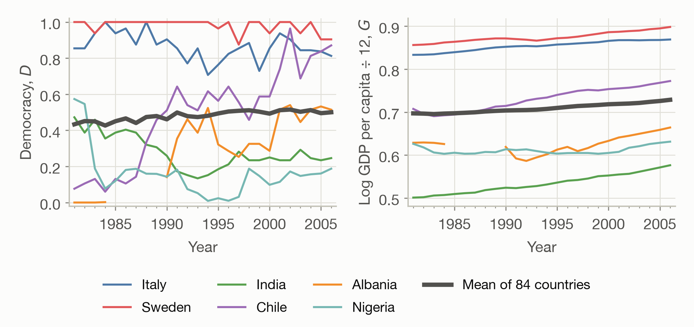
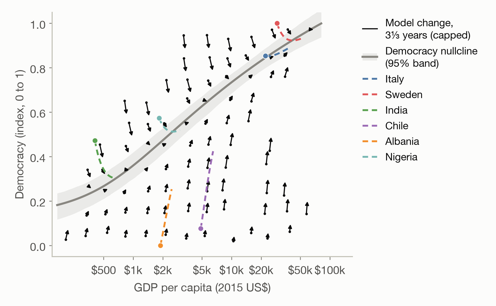
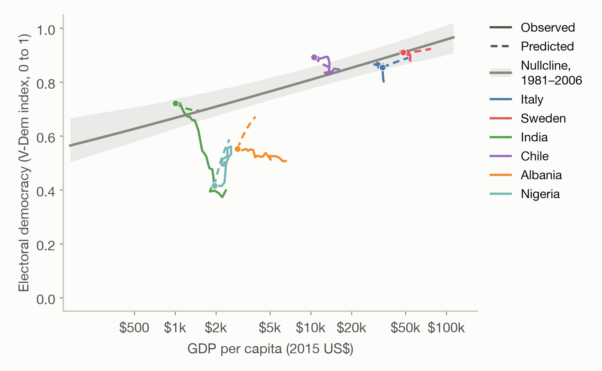

# Did the rise of democracy predict its future?

## Abstract

Richer countries tend to be more democratic, but whether rising income brings democracy, or democracy brings growth, remains disputed (Barro, 1996; Acemoglu et al., 2008; Acemoglu et al., 2019). Using data up to 2006, Ranganathan, Spaiser and Sumpter (2013) modelled the yearly changes in democracy and income as functions of the current levels of both, and found countries converging on a path along which democracy rises with income. We look again at that description. We replicate that work and also replace the index with V-Dem's electoral democracy index, which changes the exact equations but not the picture of democracy converging on a level that rises with income, and of faster growth in more democratic and in poorer countries. These are associations, not evidence of cause. We then ask whether the description, as it stood in 2006, predicts 2007–2024. It does not. It does no better than assuming every country changes by the average amount, and countries moved away from the level of democracy it predicts. The model describes the last decades of democratic expansion, not the democratic recession that followed.

## Introduction

Richer countries tend to be more democratic (Acemoglu et al., 2008), but what lies behind this is disputed. Rising living standards predict rising democracy (Barro, 1999), yet the link disappears when each country is compared only with itself over time (Acemoglu et al., 2008). Whether democracy raises growth is also contested: Barro (1996) found a weakly negative effect and Acemoglu et al. (2019) a sizeable positive one. How democracy is measured matters too, because indices define and combine its parts differently (Munck & Verkuilen, 2002). The world these studies describe has also changed. Average freedom in the world improved in 25 of the 32 years from 1974 to 2005, but around 2006 that expansion came to a halt, and the world has since been in what Diamond (2015) calls a mild but protracted democratic recession. A third wave of autocratisation is now under way, mostly through gradual erosion within democracies rather than coups (Bermeo, 2016; Lührmann & Lindberg, 2019).

Most studies estimate one direction of the relationship at a time, with a form fixed in advance. Ranganathan, Spaiser and Sumpter (2013) instead model the yearly change in each variable as a function of the current levels of both, and let the data choose the form, so that relationships in both directions, including non-linear ones, can appear in one model (Spaiser et al., 2014). Applied to democracy and GDP per capita for 1980–2006, the approach described countries converging on a path along which democracy and income rise together (Ranganathan, Spaiser & Sumpter, 2013).

We look again at that description in three steps. First we refit the model to the democracy index it was built on: the citizen rights index of Welzel (2013), with GDP per capita, for 1981–2006, the last decades of democratic expansion. Then we replace that index with V-Dem's electoral democracy index (Coppedge et al., 2025), which, like Welzel's, runs from 0 to 1 and is built from expert codings, and which continues to 2024. Finally we ask whether the model, as it could have been fitted with data up to 2006, predicts what happened from 2007 to 2024, the years of democratic recession (Diamond, 2015). The questions are about association, not cause.

## Methods

### Data

GDP per capita is from the World Bank (2026; indicator NY.GDP.PCAP.KD), in constant 2015 US dollars. Welzel's index, the one used in the original study, is taken from the Quality of Government dataset (Teorell et al., 2015), and V-Dem's from its version 15 (indicator v2x_polyarchy). A yearly change is the difference between consecutive years in which a country has both variables. For 1981–2006 this gives about 3,400 changes from 183 countries with Welzel's index, and about 4,000 from 171 countries with V-Dem's. For 2007–2024 there are about 3,100 V-Dem changes. In the model GDP enters as its natural logarithm divided by 12, written $G$; a yearly change of $x$ in $G$ is growth of about $12x$.

### Model

Each yearly change is a sum of terms drawn from nine polynomials in democracy $D$ and $G$: $1, D, G, 1/G, D/G, DG, D^2, G^2$ and $1/G^2$. These are the original study's thirteen, without the four that divide by democracy, which is zero in some country-years. All countries are pooled, so a country's expected change depends only on where it is, not on which country it is.

### Model selection and uncertainty

For each equation we fitted every combination of terms, kept the best of each size, and chose between sizes by their Bayesian evidence, with a normal prior on the coefficients (Ranganathan et al., 2014). Because a country's growth persists from one year to the next, we also refitted on countries resampled with replacement to see which parts of the model are stable.

### Dynamics

From the fitted equations we found, for each level of income, the level of democracy at which democracy stops changing, the democracy nullcline. We then stepped countries forward a year at a time to see where the model takes them.

### Prediction

To test prediction, we fitted the model with V-Dem's index to 1981–2006. We then compared its predictions for 2007–2024, both year by year and for each country's state in 2024, with those of a model that assumes every country changes by the average amount.

## Results

Figure 1 shows six countries over time, and Figure 2 their paths through the plane of income and democracy. GDP is on a logarithmic scale, so equal distances are equal proportional changes. Figure 3 averages all the observed yearly changes within cells of that plane. Each arrow points in the direction countries in that cell moved.

<small><b>Figure 1.</b> Democracy, <em>D</em>, measured by Welzel's citizen rights index (left), and GDP per capita in constant 2015 US dollars on a logarithmic scale (right), from 1981 to 2006. Lines are six countries: Italy, Sweden, India, Chile, Albania and Nigeria. Albania has no observations for 1985–1989, shown as a gap.</small>

<small><b>Figure 2.</b> Democracy, <em>D</em>, measured by Welzel's citizen rights index, against GDP per capita in constant 2015 US dollars on a logarithmic scale. Grey points are the 181 countries with both variables in 2006. Coloured lines are the paths of the six countries in Figure 1 from 1981 to 2006, with a filled circle at 1981.</small>

<small><b>Figure 3.</b> Observed yearly changes in democracy (Welzel's citizen rights index) and GDP per capita (constant 2015 US dollars, logarithmic scale), averaged within cells of a grid. Each cell spans a factor of about 1.6 in GDP per capita and 0.1 in democracy. Each arrow starts at the average position of the country-years in its cell, marked by a dot, and points along their average yearly change. Arrows are drawn at 3⅓ times the yearly change, and the 33 longest are shortened to 0.47 cm, with their direction unchanged. Cells with fewer than 10 yearly changes have no arrow; the 83 cells with arrows hold 3,289 of the 3,423 changes. Faint lines are the paths of the six countries in Figures 1 and 2.</small>

### Does the original description hold?

Refitted to Welzel's index for 1981–2006, the selected model is

$$\Delta D = 0.267\,D - 0.144\,\frac{D}{G} - 0.118\,D^2 + 0.0030\,\frac{1}{G^2}$$

$$\Delta G = 0.00185\,D + 0.00027\,\frac{1}{G^2}$$

In words (details in Tables A1 and A2), democracy moves towards a level set by income. Where a country is more democratic than its income would suggest, democracy tends to fall; where it is less, democracy tends to rise. That level, the democracy nullcline, rises steadily with income, from about a quarter of the scale in the poorest countries to near the top in the richest (Figure 4). Income grows everywhere, faster in poorer countries and faster in more democratic ones. A fully democratic country grows about 2% a year faster than one with no democracy at the same income. The evidence favours these models over smaller and larger ones. When the countries are resampled, democracy stays in the growth equation, and $D/G$ and $D^2$ stay in the democracy equation, in almost every sample; the other terms vary. Stepped forward from 1981, almost every country converges on the nullcline. The countries' actual paths converge too, but more weakly. This is the original description: countries converging on a path along which democracy rises with income, although the selected equations differ in form from those first reported.

Figure 4 is read like Figure 3, but the arrows now show the change the model predicts. The grey line is the democracy nullcline, and the dashed coloured lines are where the model takes the six countries from 1981.

<small><b>Figure 4.</b> Yearly changes in democracy (Welzel's citizen rights index) and GDP per capita (constant 2015 US dollars, logarithmic scale) predicted by the selected models. Arrows show the predicted change at the positions of the arrows in Figure 3, drawn at 3⅓ times the yearly change; 14 of the 83 are shortened to 0.47 cm with their direction unchanged. The grey line is the democracy nullcline, where the predicted yearly change in democracy is zero, drawn where it lies between 0 and 1 and within the observed range of GDP, with its 95% band from 1,000 posterior draws. Dashed coloured lines, each from a dot, are the six countries' paths simulated year by year from their 1981 states to 2006.</small>

### Does it hold with another measure of democracy?

With V-Dem's index the equations take a different form (Table A1), but they say the same things (Table A2). Democracy again moves towards a level that rises with income, though less steeply. Democracy again goes with faster growth, by about the same amount, and poorer countries again grow faster.

### Did the model predict the future?

The model fitted to 1981–2006 does not predict what happened next (Table A3). Year by year, it predicts the changes from 2007 to 2024 slightly worse than assuming every country changes by the average amount. Refitted to those years, the same relationships are less than half as strong. The model expected countries to move towards the democracy nullcline, but many moved away from it, as India did (Figure 5).

<small><b>Figure 5.</b> Electoral democracy (V-Dem index, 0 to 1) against GDP per capita (constant 2015 US dollars, logarithmic scale), 2006–2024, for the six countries of Figures 1–4, each from a filled circle at its 2006 state. Solid lines are observed. Dashed lines are predicted, by stepping the model fitted to 1981–2006 forward year by year. The grey line and light grey band are that model's democracy nullcline and its 95% band from 1,000 posterior draws.</small>

## Discussion

From 1981 to 2006, democracy and GDP grew together: more democratic countries grew faster, and poorer ones did too. These are associations, not evidence that democracy causes growth, and the model explains only a small part of the variation in growth from one year to the next. Democracy also moved towards a level that rises with income, a pattern that holds across both measures even though the form of the equations does not.

The relationships did not carry over in time. After 2006 the model predicts no better than average changes, the relationships it describes became weaker, and countries moved away from the level of democracy it gives for their income. The break falls where the literature places the end of democratic expansion (Diamond, 2015) and the start of a third wave of autocratisation (Lührmann & Lindberg, 2019). Our data cannot say why. What we can say is that the model describes how democracy and income moved together between 1981 and 2006, not a relationship that held in the years since.

## Limitations

The model pools all countries, so differences in institutions, region or resources lie outside it. Democracy is measured by expert-coded indices, and the exact equations depend on which one is used. Which terms are selected also varies across samples of countries, especially among the terms in income. The equations establish association, not cause, and only within the observed range of income and democracy.

## Disclaimer

This report was written with the help of agentic AI at every stage: importing and describing the data, cleaning it, framing the questions, choosing and fitting the models, producing the figures, and drafting the text. Each step was directed and reviewed by the author, who agreed every method before it was applied, and each number reported here comes from code that can be re-run. The record of what was done, including what was tried and abandoned, is in the appendix.

## Appendix

<small><b>Table A1.</b> Selected models, fitted to 1981–2006. Coefficients are posterior means with 95% credible intervals; $G$ is the natural log of GDP per capita divided by 12. "Selected in" counts how often a term is chosen when the countries are resampled 500 times. "Without democracy" is how much lower the log-evidence is for the best GDP model with no democracy term.</small>

| Measure | Equation | Term | Coefficient (95% interval) | Selected in | Model size: posterior probability (next size) | Countries, changes |
| --- | --- | --- | --- | --- | --- | --- |
| Welzel | $\Delta D$ | $D$ | 0.267 (0.209 to 0.325) | 327 | 4 terms: 0.68 (3 terms: 0.19) | 183, 3,423 |
| | | $D/G$ | −0.144 (−0.174 to −0.113) | 488 | | |
| | | $D^2$ | −0.118 (−0.150 to −0.085) | 500 | | |
| | | $1/G^2$ | 0.0030 (0.0014 to 0.0046) | 253 | | |
| | $\Delta G$ | $D$ | 0.00185 (0.00146 to 0.00224) | 169 | 2 terms: 0.75 (3 terms: 0.19) | |
| | | $1/G^2$ | 0.00027 (0.00019 to 0.00035) | 183 | without democracy: 14.9 lower | |
| V-Dem | $\Delta D$ | $1$ | 0.0075 (0.0042 to 0.0108) | 226 | 3 terms: 0.72 (4 terms: 0.14) | 171, 3,955 |
| | | $DG$ | 0.063 (0.030 to 0.095) | 332 | | |
| | | $D^2$ | −0.071 (−0.099 to −0.042) | 466 | | |
| | $\Delta G$ | $D^2$ | 0.00226 (0.00173 to 0.00279) | 245 | 2 terms: 0.67 (1 term: 0.26) | |
| | | $1/G^2$ | 0.00025 (0.00016 to 0.00033) | 124 | without democracy: 13.0 lower | |

A democracy term is selected in the GDP equation in 492 of 500 resamples with either measure.

<small><b>Table A2.</b> What the 1981–2006 models imply. The nullcline is the level of democracy at which democracy stops changing, at stated levels of GDP per capita (constant 2015 US dollars). Growth is predicted yearly GDP growth over the observed range of the data. Extra growth compares democracy 1 with 0 for Welzel's index, and 0.9 with 0.013 for V-Dem's, whose values do not reach the ends of the scale. Convergence counts the countries ending closer to the nullcline in 2006 than at their first observed year, with the median distance from it at the start and the end.</small>

| | Welzel | V-Dem |
| --- | --- | --- |
| Nullcline at \$500 | 0.27 | 0.63 |
| Nullcline at \$2,000 | 0.47 | 0.71 |
| Nullcline at \$5,000 | 0.63 | 0.77 |
| Nullcline at \$10,000 | 0.73 | 0.81 |
| Nullcline at \$50,000 | 0.95 | 0.91 |
| Predicted yearly growth, observed range | 0.3% to 4.1% | 0.3% to 4.4% |
| Extra growth, top against bottom of the index | 2.2% (1.8% to 2.7%) | 2.2% (1.7% to 2.8%) |
| Convergence, simulated | 168 of 183 (0.23 to 0.08) | 158 of 171 (0.48 to 0.22) |
| Convergence, observed | 104 of 183 (0.23 to 0.15) | 119 of 171 (0.48 to 0.17) |

<small><b>Table A3.</b> Prediction of 2007–2024 by the V-Dem model fitted to 1981–2006. Year by year: mean log predictive density per change (higher is better) for 3,088 changes from 174 countries, against a model in which every country changes by the 1981–2006 average amount, and against the same terms refitted to 2007–2024. In 2024: errors for the 168 countries observed in both 2006 and 2024, stepped forward from 2006.</small>

| | Democracy | GDP per capita |
| --- | --- | --- |
| Log predictive density: model | 1.839 | 3.905 |
| Log predictive density: average change | 1.840 | 3.909 |
| Log predictive density: refitted to 2007–2024 | 1.902 | 3.957 |
| Changes where the model beats the average | 43% | 44% |
| Variance explained, 2007–2024 | none (−7.1%) | none (−1.2%) |
| Median error in 2024: model | 0.15 | 27% |
| Median error in 2024: average change | 0.17 | 22% |
| Countries where the model is closer | 106 of 168 | 74 of 168 |
| Median distance to the democracy nullcline | observed 0.17 in 2006, 0.26 in 2024; model 0.08 in 2024 | |

The full workings, the data decisions and every check are in [Appendix.md](Appendix.md).

## References

Acemoglu, D., Johnson, S., Robinson, J. A. and Yared, P. (2008). [Income and democracy](https://doi.org/10.1257/aer.98.3.808). *American Economic Review*, 98(3), 808–842.

Acemoglu, D., Naidu, S., Restrepo, P. and Robinson, J. A. (2019). [Democracy does cause growth](https://doi.org/10.1086/700936). *Journal of Political Economy*, 127(1), 47–100.

Barro, R. J. (1996). [Democracy and growth](https://doi.org/10.1007/BF00163340). *Journal of Economic Growth*, 1(1), 1–27.

Barro, R. J. (1999). [Determinants of democracy](https://doi.org/10.1086/250107). *Journal of Political Economy*, 107(S6), S158–S183.

Bermeo, N. (2016). [On democratic backsliding](https://doi.org/10.1353/jod.2016.0012). *Journal of Democracy*, 27(1), 5–19.

Coppedge, M., Gerring, J., Knutsen, C. H., Lindberg, S. I., Teorell, J., Altman, D., et al. (2025). [V-Dem Country-Year Dataset v15](https://doi.org/10.23696/vdemds25). Varieties of Democracy (V-Dem) Project.

Diamond, L. (2015). [Facing up to the democratic recession](https://doi.org/10.1353/jod.2015.0009). *Journal of Democracy*, 26(1), 141–155.

Lührmann, A. and Lindberg, S. I. (2019). [A third wave of autocratization is here: what is new about it?](https://doi.org/10.1080/13510347.2019.1582029) *Democratization*, 26(7), 1095–1113.

Munck, G. L. and Verkuilen, J. (2002). [Conceptualizing and measuring democracy: evaluating alternative indices](https://doi.org/10.1177/001041400203500101). *Comparative Political Studies*, 35(1), 5–34.

Ranganathan, S., Spaiser, V., Mann, R. P. and Sumpter, D. J. T. (2014). [Bayesian dynamical systems modelling in the social sciences](https://doi.org/10.1371/journal.pone.0086468). *PLOS ONE*, 9(1), e86468.

Ranganathan, S., Spaiser, V. and Sumpter, D. J. T. (2013). [A Bayesian approach to modeling dynamical systems in the social sciences](https://doi.org/10.5220/0004480901250131). In *Proceedings of the 3rd International Conference on Simulation and Modeling Methodologies, Technologies and Applications (SIMULTECH 2013)*, pp. 125–131. SCITEPRESS.

Spaiser, V., Ranganathan, S., Mann, R. P. and Sumpter, D. J. T. (2014). [The dynamics of democracy, development and cultural values](https://doi.org/10.1371/journal.pone.0097856). *PLOS ONE*, 9(6), e97856.

Teorell, J., Dahlberg, S., Holmberg, S., Rothstein, B., Hartmann, F. and Svensson, R. (2015). [The Quality of Government Standard Dataset, version Jan15](https://www.qogdata.pol.gu.se/dataarchive/qog_std_ts_jan15.csv). University of Gothenburg: The Quality of Government Institute.

Welzel, C. (2013). *Freedom Rising: Human Empowerment and the Quest for Emancipation*. Cambridge University Press. [Open-access PDF](https://cambridge.org/de/files/8613/8054/8416/FreedomRising_OA.pdf).

World Bank (2026). [GDP per capita (constant 2015 US$), NY.GDP.PCAP.KD](https://api.worldbank.org/v2/en/indicator/NY.GDP.PCAP.KD?downloadformat=csv). World Development Indicators, release last updated 11 November 2026.
