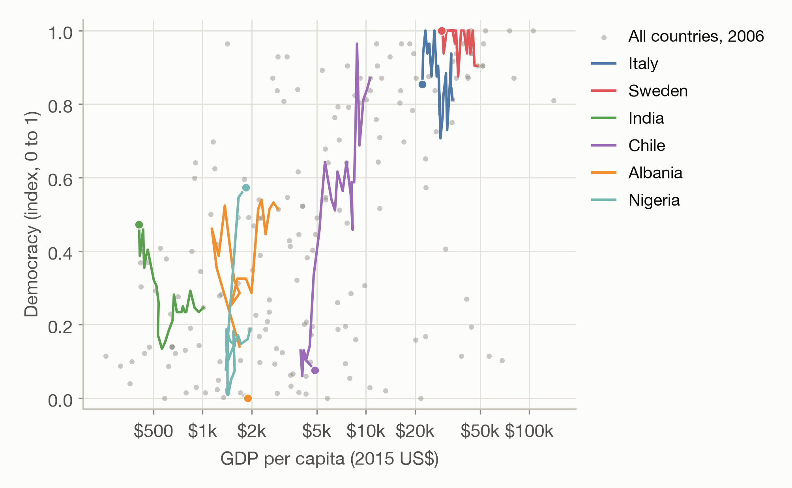
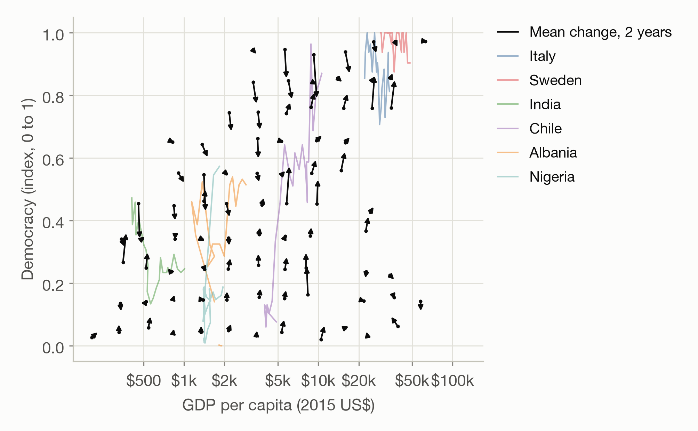

# [Title]

*Suggested at the end of step 6, once the argument is settled.*

## Abstract

*Written last, in step 6, after every other section is final.*

## Introduction

*Background and prior literature to be added later.*

We look at how democracy and national income change together, using two country-level variables between 1981 and 2006. The first is GDP per capita, from the World Bank, in constant 2015 US dollars. It runs from about \$160 to \$140,000 per person. For the model we take its natural logarithm and divide by 12, so that it runs from about 0.4 to 1. Figures show it in dollars on a logarithmic scale. The second is the citizen rights index of Welzel (2013). It combines Freedom House ratings of political rights and civil liberties with Cingranelli–Richards scores of how far rights are respected in practice, and runs from 0, no citizen rights, to 1. It's one way of measuring democracy, and it is built from expert codings, not measured directly.

Rather than relating the level of one variable to the level of the other, we model the yearly change in each as a function of the current levels of both. The two equations together describe a dynamical system. Following Ranganathan, Spaiser and Sumpter (2013), each change is written as a sum of terms from a fixed set of polynomials in the two variables. The data choose which terms enter: the best-fitting model is found for each number of terms, and models with different numbers of terms are compared by their Bayesian evidence. All countries are pooled, so we assume that every country follows the same dynamics from wherever it starts. The questions we look at are of association rather than cause. A term in the equation for the change in democracy says how that change varies with income, not that income drives it.

1. How does the yearly change in democracy depend on the current levels of democracy and GDP per capita?
2. How does the yearly change in GDP per capita depend on the current levels of democracy and GDP per capita?
3. What do the two equations imply together: where does change stop, which way do countries move, and do their trajectories converge onto a common path?

## Methods

### Data

GDP per capita is World Bank indicator NY.GDP.PCAP.KD, in constant 2015 US dollars (World Bank, 2026). Democracy is the citizen rights index of Welzel (2013), taken from the January 2015 release of the Quality of Government dataset (Teorell et al., 2015), where values coded −99 are missing. The two are joined by country and year for 1981 to 2006. A yearly change is the difference between consecutive years in which a country has both variables, so a country with gaps contributes fewer changes rather than none. This gives 3,423 yearly changes from 183 countries. In the model, GDP enters as $G = \ln(\text{GDP per capita})/12$, which runs from 0.43 to 0.99. Coefficients are on this scale. A yearly change of $x$ in $G$ is growth in GDP per capita of $e^{12x} - 1$, about $12x$ for small changes, so a change of 0.001 in $G$ is growth of about 1.2%.

### Model

The yearly change in each variable is modelled as a sum of terms in the current levels of both, $\Delta D = f_D(D, G) + \varepsilon$ and $\Delta G = f_G(D, G) + \varepsilon$, where $\varepsilon$ is normally distributed noise. Following Ranganathan, Spaiser and Sumpter (2013), the terms are drawn from a fixed set: $1, D, G, 1/G, D/G, DG, D^2, G^2$ and $1/G^2$. Terms with democracy in the denominator are left out, because democracy is exactly zero in 108 country-years. All countries and years are pooled.

### Model selection and uncertainty

For each equation we fitted all 512 combinations of terms by least squares and kept the best-fitting combination of each size. We compared sizes by their Bayesian evidence, the probability of the observed changes averaged over the prior (Ranganathan et al., 2014). The noise standard deviation is fixed at the standard deviation of the observed changes. The prior on the coefficients is normal: each term is first divided by its root-mean-square value, and the prior standard deviation is again the standard deviation of the observed changes, so that a term at its typical size is expected to move the variable by about one typical yearly change. The evidence and the posterior distribution of the coefficients then have closed forms. We report the size with the highest evidence, its posterior probability with every size equally likely beforehand, and 95% credible intervals for its coefficients. To see how much the result depends on particular countries, we refitted on 500 samples of the countries drawn with replacement.

### Dynamics

From the selected equations, we computed for each level of GDP the level of democracy at which the yearly change in democracy is zero, and whether changes on either side point towards it or away. We repeated this for 1,000 draws of the coefficients from their posterior distribution to give a 95% band. We also checked whether the yearly change in GDP is zero anywhere in the observed range. To see where the equations take countries, we stepped them forward one year at a time from each country's first observed state to 2006. We then measured each country's distance from the zero-change curve in democracy, at the start and at the end. We measured the same distance for the observed paths.

## Results

Figures 1 and 2 show the same data in two ways. Figure 1 plots each variable against time. Figure 2 plots the two variables against each other, so that a country's path through the figure is the sequence of states it passed through between 1981 and 2006. In Figure 2, a line moving up is a country becoming more democratic, and a line moving right is a country becoming richer. GDP is on a logarithmic scale, so equal distances are equal proportional changes: moving from \$1,000 to \$2,000 is the same distance as moving from \$10,000 to \$20,000.

<small><b>Figure 1.</b> Democracy, <em>D</em> (left), and GDP per capita in constant 2015 US dollars on a logarithmic scale (right), from 1981 to 2006. Lines are six countries: Italy, Sweden, India, Chile, Albania and Nigeria. Albania has no observations for 1985–1989, shown as a gap.</small>

<small><b>Figure 2.</b> Democracy, <em>D</em>, against GDP per capita in constant 2015 US dollars on a logarithmic scale. Grey points are the 181 countries with both variables in 2006. Coloured lines are the paths of the six countries in Figure 1 from 1981 to 2006, with a filled circle at 1981.</small>

Figure 3 summarises all 3,423 observed yearly changes on the same axes as Figure 2. The plane is divided into a grid of cells, and each arrow stands for the country-years in one cell. It starts at their average position and points along their average yearly change, drawn over 3⅓ years so that its direction is easy to see. The longest arrows are shortened to a maximum length, with their direction unchanged. An arrow pointing up is a cell in which democracy rose on average. An arrow pointing right is a cell in which GDP per capita grew, and because the GDP axis is logarithmic, the arrow's horizontal length is proportional growth.

<small><b>Figure 3.</b> Observed yearly changes in democracy and GDP per capita (constant 2015 US dollars, logarithmic scale), averaged within cells of a grid. Each cell spans a factor of about 1.6 in GDP per capita and 0.1 in democracy. Each arrow starts at the average position of the country-years in its cell, marked by a dot, and points along their average yearly change. Arrows are drawn at 3⅓ times the yearly change, and the 33 longest are shortened to 0.47 cm, with their direction unchanged. Cells with fewer than 10 yearly changes have no arrow; the 83 cells with arrows hold 3,289 of the 3,423 changes. Faint lines are the paths of the six countries in Figures 1 and 2.</small>

### The fitted model and its dynamics

The selected equations, fitted to 3,423 yearly changes from 183 countries, are

$$\Delta D = 0.267\,D - 0.144\,\frac{D}{G} - 0.118\,D^2 + 0.0030\,\frac{1}{G^2}$$

$$\Delta G = 0.00185\,D + 0.00027\,\frac{1}{G^2}$$

The 95% credible intervals are 0.209 to 0.325 for $D$, −0.174 to −0.113 for $D/G$, −0.150 to −0.085 for $D^2$ and 0.0014 to 0.0046 for $1/G^2$ in the democracy equation, and 0.00146 to 0.00224 for $D$ and 0.00019 to 0.00035 for $1/G^2$ in the GDP equation. The posterior probability of the selected size is 0.68 for the democracy equation and 0.75 for the GDP equation, against 0.19 for the next most probable size in each. Democracy enters the GDP equation: a country at democracy 1 grows about 2.2% a year faster than one at democracy 0 (1.8% to 2.7%), and the best GDP model without democracy has a log-evidence 14.9 lower. When the countries are resampled, $D/G$ and $D^2$ are selected for the democracy equation in at least 488 of 500 samples, and a democracy term for the GDP equation in 492, but the other terms vary, and the coefficient ranges are up to about one and a half times as wide as the credible intervals.

Together, the two equations make the yearly change in democracy zero along a curve that rises with GDP per capita, the democracy nullcline (Figure 4). On the nullcline, democracy is 0.27 at \$500 per person, 0.47 at \$2,000, 0.63 at \$5,000, 0.73 at \$10,000, 0.83 at \$20,000 and 0.95 at \$50,000, with a 95% band about 0.11 wide. Below it democracy rises and above it democracy falls, at every level of GDP in the observed range. GDP per capita grows everywhere in that range, by 0.3% to 4.1% a year, so there is no point where both changes stop. Stepped forward from their first observed states to 2006, 168 of the 183 countries end closer to the nullcline than they started, and their median distance from it falls from 0.23 to 0.08. In the observed data, 104 countries end closer, and the median distance falls from 0.23 to 0.15.

Figure 4 is read like Figure 3, but the arrows now show the change predicted by the two equations at the same positions, not the observed average. The grey line is the democracy nullcline, where the predicted change in democracy is zero, and the light grey band is its 95% interval. The coloured lines with a dot are where the equations take each of the six countries from its 1981 state; their observed paths are in Figure 2.

<small><b>Figure 4.</b> Yearly changes in democracy and GDP per capita (constant 2015 US dollars, logarithmic scale) predicted by the selected models. Arrows show the predicted change at the positions of the arrows in Figure 3, drawn at 3⅓ times the yearly change; 14 of the 83 are shortened to 0.47 cm with their direction unchanged. The grey line is the democracy nullcline, where the predicted yearly change in democracy is zero, drawn where it lies between 0 and 1 and within the observed range of GDP, with its 95% band from 1,000 posterior draws. Coloured lines with a dot are the six countries' paths simulated year by year from their 1981 states to 2006.</small>

## Discussion

*Written in step 5, organised by theme rather than by sub-question.*

## Limitations

*Written in step 5, alongside the discussion. What qualifies the findings taken together, collected in one place.*

## Disclaimer

This report was written with the help of agentic AI at every stage: importing and describing the data, cleaning it, framing the questions, choosing and fitting the models, producing the figures, and drafting the text. Each step was directed and reviewed by the author, who agreed every method before it was applied, and each number reported here comes from code that can be re-run. The record of what was done, including what was tried and abandoned, is in the appendix.

## Appendix

*A pointer to [Appendix.md](Appendix.md), where the data, the decisions and the full workings are recorded.*

## References

Ranganathan, S., Spaiser, V., Mann, R. P. and Sumpter, D. J. T. (2014). [Bayesian dynamical systems modelling in the social sciences](https://doi.org/10.1371/journal.pone.0086468). *PLOS ONE*, 9(1), e86468.

Ranganathan, S., Spaiser, V. and Sumpter, D. J. T. (2013). [A Bayesian approach to modeling dynamical systems in the social sciences](https://doi.org/10.5220/0004480901250131). In *Proceedings of the 3rd International Conference on Simulation and Modeling Methodologies, Technologies and Applications (SIMULTECH 2013)*, pp. 125–131. SCITEPRESS.

Teorell, J., Dahlberg, S., Holmberg, S., Rothstein, B., Hartmann, F. and Svensson, R. (2015). [The Quality of Government Standard Dataset, version Jan15](https://www.qogdata.pol.gu.se/dataarchive/qog_std_ts_jan15.csv). University of Gothenburg: The Quality of Government Institute.

Welzel, C. (2013). *Freedom Rising: Human Empowerment and the Quest for Emancipation*. Cambridge University Press. [Open-access PDF](https://cambridge.org/de/files/8613/8054/8416/FreedomRising_OA.pdf).

World Bank (2026). [GDP per capita (constant 2015 US$), NY.GDP.PCAP.KD](https://api.worldbank.org/v2/en/indicator/NY.GDP.PCAP.KD?downloadformat=csv). World Development Indicators, release last updated 11 November 2026.
